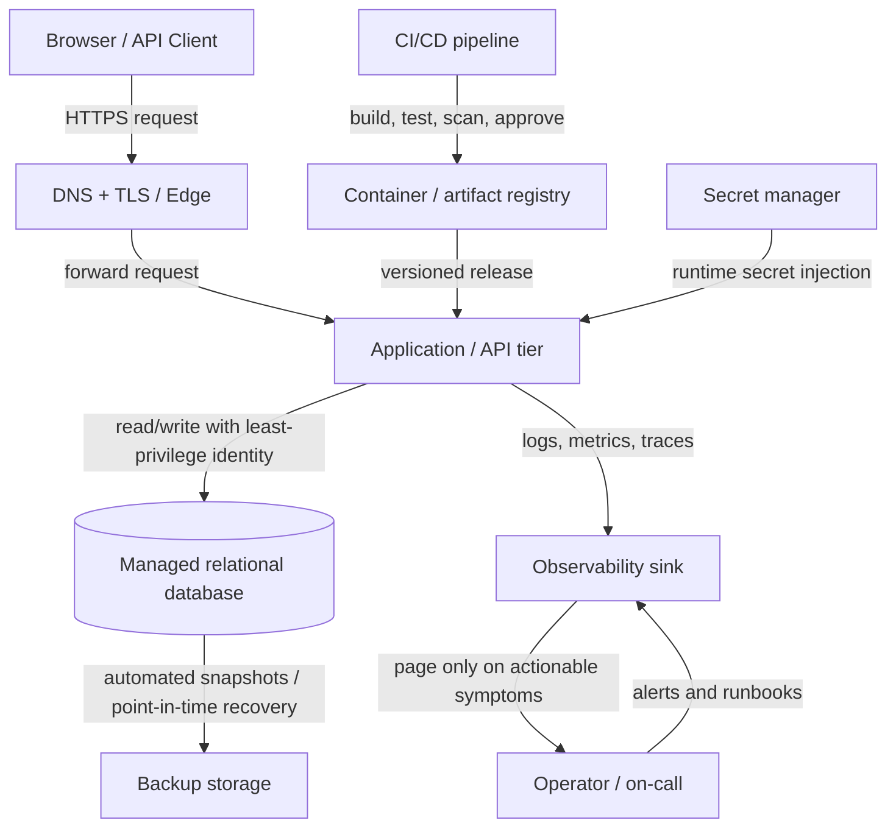

# Service Blueprint, SLOs & Cloud Cost Envelope
**Status:** Complete design draft | **Date:** 29 October 2026  
**Service:** Small two-tier web application (browser/API + managed relational database)  
**Currency:** INR, monthly estimates; planning estimates only, not vendor quotes.

## 1. Scope and assumptions
- User-facing web application with a stateless application/API tier and a relational data tier.
- HTTPS only; one primary cloud region; managed database; object storage for backups and static assets.
- Three traffic profiles: Lean (500 expected users), Balanced (5,000), Resilient (25,000).
- Monthly budgets from the provided starter CSV are treated as hard planning envelopes: ₹2,500 / ₹8,000 / ₹25,000.
- Cost figures are illustrative estimates for planning and must be validated against the selected provider's live calculator, region, taxes, and actual usage before procurement.
- Availability is measured monthly at the service boundary. Planned maintenance is not silently excluded unless explicitly communicated in the service's published policy.

## 2. Two-tier service blueprint

### Logical architecture

### Request path
1. Client resolves DNS and establishes HTTPS/TLS.
2. Edge/load balancer forwards request to the application tier.
3. Application validates input, authenticates/authorizes, applies request limits, and assigns a correlation ID.
4. Application performs a bounded database operation using a service identity with only required table/operation permissions.
5. Application returns a response; latency and result class are recorded without logging secrets or sensitive payloads.
6. Metrics, structured logs, and traces are emitted asynchronously so observability failures do not block normal requests.

### Dependency path
- Required runtime dependencies: DNS/TLS, application runtime, relational database, secret manager, and identity provider if authentication is external.
- Optional/non-critical dependencies (analytics, email, external enrichment) must have timeouts, retries with jitter, circuit breakers, and graceful degradation.
- Database connection pool is bounded. No unbounded retries; retry only idempotent operations.
- Every external call has a timeout. A dependency outage must not create a retry storm.

### Deployment path
1. Pull request → lint/type checks → unit/integration tests → dependency and secret scan.
2. Build immutable artifact and attach version/commit metadata.
3. Deploy to staging; run smoke tests and database migration compatibility checks.
4. Require approval for production; use rolling or canary rollout with health checks.
5. Monitor golden signals during rollout; automatically stop/rollback if error rate or latency breaches the release guardrail.
6. Database changes follow expand/migrate/contract: deploy backward-compatible schema first, then application, then remove old schema only after verification.
7. Keep the previous known-good artifact available for rollback.

### Data path
- Primary application records live in a managed relational database.
- Use TLS in transit and provider-managed encryption at rest; restrict access by workload identity and network policy.
- Backups are encrypted, access-controlled, and stored separately from the primary database failure domain where supported.
- Retention baseline: daily backups retained 7 days; monthly recovery point retained 30 days, subject to the chosen provider's capabilities and budget.
- Do not place credentials, tokens, payment details, or unnecessary personal data in logs.
- Define data deletion and retention rules before production launch.

### Failure paths and responses
| Failure | Detection | Immediate response | Recovery / prevention |
|---|---|---|---|
| Application instance crash | Health check, 5xx rate | Remove unhealthy instance; restart/replace | Multi-instance deployment for Balanced/Resilient; rollback bad release |
| Database unavailable | Connection errors, DB health | Fail fast with bounded timeout; return safe 503 | Managed failover where available; restore/failover runbook |
| Slow database/query | DB latency, pool saturation | Timeouts; shed non-critical work | Index/query review, pool tuning, load tests |
| Bad deployment | Error/latency regression after release | Halt rollout and rollback | Canary, smoke tests, migration compatibility |
| Secret unavailable/expired | Secret retrieval/auth failures | Fail closed; do not use hard-coded fallback | Secret rotation alerts and tested recovery |
| Region outage | Synthetic checks and provider status | Declare incident; follow recovery plan | Resilient profile needs cross-region recovery design and tested backups |
| Logging/metrics outage | Missing telemetry heartbeat | Serve requests if safe; alert separately | Local buffering with limits; never block user requests indefinitely |
| Traffic spike / abuse | Rate, queue, CPU, 429/5xx | Rate-limit and autoscale within budget | Capacity test, quotas, WAF/rate rules |

## 3. SLIs, SLOs, error budget and paging

### Service Level Indicators
- **Availability SLI:** successful eligible requests (non-5xx responses) ÷ all eligible requests, measured at the edge. Exclude client-caused 4xx from failures; do not exclude server-side timeouts.
- **Latency SLI:** percentage of eligible requests completing within the scenario's p95 objective; report p50, p95 and p99 separately. The target below is a p95 threshold, not a claim that every request meets it.
- **Correctness SLI:** percentage of sampled critical writes that are persisted and read back correctly (target ≥99.95%).
- **Recovery SLI:** successful restore/failover drills completed within declared RTO/RPO (target 100% of scheduled drills).

### SLO targets from starter workbook
| Profile | Monthly availability SLO | Approx. monthly error budget* | p95 latency target | RPO | RTO |
|---|---:|---:|---:|---:|---:|
| Lean | 99.0% | 7 h 18 min | ≤800 ms | ≤24 h | ≤4 h |
| Balanced | 99.5% | 3 h 39 min | ≤500 ms | ≤60 min | ≤60 min |
| Resilient | 99.9% | 43 min 49 sec | ≤300 ms | ≤15 min | ≤30 min |

\*Error budget is the fraction of a 30-day month not meeting the availability SLO: 720 hours × (1 − SLO). Treat it as a service-level budget, not an entitlement to downtime.

### Paging and alert thresholds
- **Page immediately (24×7 if production is business-critical):** availability burn rate ≥14.4× over 5 minutes AND ≥6× over 1 hour; or sustained 5xx ≥5% for 5 minutes with material traffic; or confirmed data corruption/security incident.
- **Page:** p95 latency above SLO for 10 minutes with user impact; database unavailable for 2 minutes; all healthy application instances lost; RPO/RTO recovery plan invoked.
- **Ticket / business-hours alert:** CPU >75% for 15 minutes, memory >80% for 15 minutes, disk >70%, connection pool >80%, or a non-critical dependency degraded without user impact.
- **Telemetry alert:** no metrics/heartbeat for 5 minutes. Route separately from service-availability alerts to avoid hiding a telemetry failure.
- Alerts must include service, environment, symptom, impact, dashboard, runbook, recent deployment and owner. Avoid paging on a single noisy metric without evidence of user impact.

### Error-budget policy
- If more than 50% of the rolling 30-day error budget is consumed in 7 days, pause non-essential feature releases and prioritize reliability work.
- If the budget is exhausted, freeze risky releases until the service returns within SLO and a blameless review identifies corrective actions.
- Review SLOs monthly and after major incidents; do not lower targets simply to silence alerts.

## 4. Monthly cloud cost envelope

The provided starter CSV specifies total budgets, traffic assumptions, availability/latency goals and recovery objectives. This model allocates each envelope across six cost categories. Values are planning allocations, not provider prices.

| Cost category (₹/month) | Lean: 500 users | Balanced: 5,000 users | Resilient: 25,000 users |
|---|---:|---:|---:|
| Compute / application runtime | 700 | 2,400 | 7,500 |
| Database / storage | 500 | 1,600 | 4,500 |
| Network / data transfer | 150 | 700 | 2,500 |
| Logs, metrics, traces | 250 | 800 | 2,000 |
| Backups / recovery storage | 200 | 500 | 1,500 |
| Support / operations allowance | 700 | 2,000 | 7,000 |
| **Total monthly envelope** | **2,500** | **8,000** | **25,000** |
| **Annualized planning total** | **30,000** | **96,000** | **300,000** |

### Scenario design and trade-offs
- **Lean:** single region, small application footprint, minimal managed services. Lowest cost; RPO 24 h / RTO 4 h means slower recovery. Suitable for a prototype or low-criticality service only.
- **Balanced (recommended default):** managed database, autoscaling application tier, automated backups, actionable monitoring. Better operational balance; still primarily single-region unless cross-region recovery is separately funded.
- **Resilient:** multi-zone service components, tested backups, capacity headroom and stronger recovery design. A ₹25,000 envelope may not cover true active-active multi-region operation for every provider; confirm calculator prices and narrow the scope if necessary.

### Cost controls
- Set budget alerts at 50%, 75%, 90% and 100% of the monthly envelope.
- Tag resources by service, environment, owner and cost center.
- Apply log retention and sampling; never remove security/audit logs required by policy.
- Configure autoscaling limits and database/storage quotas to prevent runaway spend.
- Review actual versus estimated cost weekly for the first month, then monthly.
- Re-estimate from real requests/day, average response size, database size/IOPS, retention, egress and backup growth before launch.

## 5. Architecture Decision Records (ADRs)

### ADR-001 — Primary region
**Status:** Proposed  
**Decision:** Select one primary region near the majority of users and required data residency, after verifying service availability and price. Keep the deployment region explicit in infrastructure configuration.  
**Rationale:** Lower latency and simpler operations; avoids premature multi-region complexity.  
**Consequences:** Regional outage recovery is limited in Lean/Balanced. Resilient requires a documented secondary-region strategy and a tested failover path.  
**Revisit when:** user geography, residency requirements, or SLOs change.

### ADR-002 — Recovery objectives and backups
**Status:** Proposed  
**Decision:** Adopt profile-specific RPO/RTO targets: Lean 24h/4h; Balanced 60m/60m; Resilient 15m/30m. Use encrypted automated backups and schedule restore drills.  
**Rationale:** Recovery targets determine backup frequency, replication, and cost.  
**Consequences:** The tighter Resilient target requires point-in-time recovery/replication and evidence from tests; backup existence alone is not proof of recoverability.  
**Revisit when:** business impact analysis changes.

### ADR-003 — Secrets and configuration
**Status:** Accepted design rule  
**Decision:** Store credentials and API keys in a managed secret store; inject them at runtime through workload identity. Never commit secrets to source control, images, logs, or frontend bundles. Rotate on a defined schedule and after suspected exposure.  
**Rationale:** Limits credential leakage and enables rotation/auditing.  
**Consequences:** Secret-store outage/permission errors must be monitored; production should fail closed rather than use hard-coded fallback credentials.

### ADR-004 — Least-privilege access
**Status:** Accepted design rule  
**Decision:** Separate human, CI/CD, application and database identities. CI/CD can deploy only to its intended environment; runtime identity can access only required secrets and database operations; humans use MFA and time-bound elevated access.  
**Rationale:** Limits blast radius from compromised accounts or workloads.  
**Consequences:** Permission changes require review and audit; avoid shared admin keys and long-lived access tokens.

### ADR-005 — Release and rollback
**Status:** Proposed  
**Decision:** Use immutable artifacts, automated tests, staging smoke tests, production approval and canary/rolling release with a rollback trigger tied to SLO symptoms.  
**Rationale:** Reduces risk of deploying a regression directly to all users.  
**Consequences:** Schema migrations must remain backward compatible during rollback windows.

## 6. Operational readiness checklist
- [ ] Confirm actual provider, region, pricing calculator and tax assumptions.
- [ ] Run load test at expected peak plus 2× headroom.
- [ ] Verify dashboards and test each page/ticket route.
- [ ] Test application rollback and database restore.
- [ ] Validate backup encryption, retention and access permissions.
- [ ] Test secret rotation and workload identity permissions.
- [ ] Publish service status/incident communication procedure.
- [ ] Record an owner and review date for every SLO and ADR.

## 7. Submission note
This package is a provider-neutral design deliverable. Before representing it as production-validated, replace planning cost allocations with a dated provider-calculator export and attach evidence of a restore drill, load test, and alert test. A public submission URL must be created by publishing this package to a repository or document host; no external account was accessed to publish it automatically.
